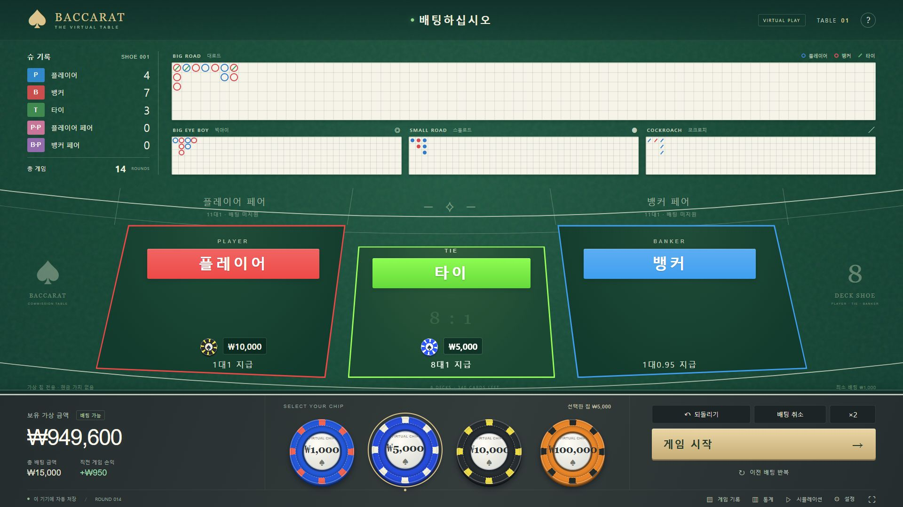

# BACCARAT — The Virtual Table

실제 전자식 바카라 터치 테이블의 배치에서 영감을 얻은 한국어 가상 바카라 시뮬레이터입니다. PC 1920×1080 화면을 우선으로 만들었고, 작은 화면에서는 전용 배치로 전환합니다. 실제 서비스의 로고·상표나 첨부 사진 파일을 사용하지 않았습니다.



현금 결제, 입금, 출금, 환전, 계정, 외부 분석 서비스는 없습니다. 금액은 모두 연습용 가상 크레딧입니다.

## 바로 실행

배포 ZIP에 포함된 **`dist/offline.html`을 브라우저로 열면 설치 없이 실행**할 수 있습니다. 이 파일은 CSS와 JavaScript가 포함된 단일 HTML입니다. 브라우저의 로컬 파일 저장 정책에 따라 기록 보관이 제한될 수 있으므로, 지속 사용에는 아래 로컬 서버나 GitHub Pages를 권장합니다.

소스에서 실행하려면 Node.js 22 이상이 필요합니다. 외부 패키지는 사용하지 않으므로 `npm install`이 필요 없습니다.

```sh
node scripts/serve.mjs
```

브라우저에서 `http://127.0.0.1:4173`을 엽니다. 서버 종료는 터미널에서 `Ctrl+C`입니다.

```sh
node --test                 # 게임 엔진, 정산, 로드, 저장 검증
node scripts/build.mjs      # dist/ 생성, 단일 offline.html 포함
node scripts/serve.mjs --dist  # 빌드 결과 미리보기
```

npm이 설치되어 있다면 `npm run dev`, `npm test`, `npm run build`도 동일하게 동작합니다.

## GitHub에 올려 웹사이트로 사용

1. GitHub에서 저장소를 만들고 **이 폴더의 내용**을 저장소 루트에 올립니다. `index.html`, `src/`, `scripts/`, `tests/`, `package.json`, `.github/workflows/pages.yml`을 포함하세요. 상위 폴더의 다른 프로젝트 자료는 올리지 마세요.
2. 기본 브랜치 이름을 `main`으로 사용합니다. 다른 이름이면 `.github/workflows/pages.yml`의 브랜치도 수정하세요.
3. 저장소 **Settings → Pages → Build and deployment → Source**를 **GitHub Actions**로 선택합니다.
4. `main`에 커밋을 올리거나 Actions 탭에서 **Test and deploy GitHub Pages → Run workflow**를 실행합니다.
5. 테스트와 빌드가 통과하면 Pages에 배포됩니다. 배포 주소는 워크플로 실행 결과와 Settings → Pages에서 확인할 수 있습니다.

리포지토리 하위 경로(`https://사용자명.github.io/저장소명/`)에서도 작동하도록 모든 자산 경로는 상대 경로입니다. 서버·API 키·별도 데이터베이스는 필요하지 않습니다. PR에서는 테스트와 빌드만 실행하고 배포하지 않습니다.

공식 참고: [GitHub Pages 사용자 지정 워크플로](https://docs.github.com/en/pages/getting-started-with-github-pages/using-custom-workflows-with-github-pages).

## 제공 기능

- 녹색 테이블과 곡선 가이드, 플레이어 **빨강** / 타이 **초록** / 뱅커 **파랑** 배팅 영역
- ₩1,000 / ₩5,000 / ₩10,000 / ₩100,000 입체 칩, 반복 클릭 누적과 칩 스택 표시
- 배팅 되돌리기·전체 취소·두 배·직전 배팅 반복
- 자동 카드 배분, 합계 점수, 결과 강조, 다음 판 자동 전환
- 대로드, 빅아이, 스몰, 코크로치와 현재 슈 결과 집계
- 가상 잔액, 현재 배팅, 직전 손익, 누적 통계
- 브라우저 저장 복구, 최근 2,000판 CSV 내보내기
- 현재 테이블과 독립적인 100 / 1,000 / 10,000판 시뮬레이션과 손익 그래프
- 빠른 애니메이션, 선택적 효과음, 새 슈, 가상 금액 충전, 확인 절차가 있는 초기화
- 터치와 키보드 입력, `prefers-reduced-motion` 대응

숫자 `1`~`4`로 칩을 선택하고 `Enter`로 시작할 수 있습니다. 버튼이나 입력 폼에 포커스가 있으면 해당 요소의 기본 키 동작을 우선합니다. `Esc`는 열린 창을 닫습니다.

## 게임 규칙

표준 **커미션 바카라**를 구현했습니다. 참고 사진의 장비가 사용하는 비커미션 규칙과는 다를 수 있습니다. 요청한 뱅커 `1대0.95` 지급률을 적용합니다.

| 배팅 | 승리 시 순이익 | 원금 포함 반환 | 타이 발생 시 |
| --- | --- | --- | --- |
| 플레이어 | 1배 | 2배 | 원금 반환 |
| 뱅커 | 0.95배 | 1.95배 | 원금 반환 |
| 타이 | 8배 | 9배 | 승리 정산 |

- A는 1점, 2~9는 해당 점수, 10/J/Q/K는 0점입니다. 합계의 일의 자리를 사용합니다.
- P → B → P → B 순서로 나눕니다. 어느 쪽이든 초기 8·9점이면 내추럴로 추가 카드를 배분하지 않습니다.
- 플레이어 초기 합계 0~5는 한 장 추가, 6~7은 스탠드입니다. 뱅커는 자신의 초기 합계와 플레이어의 세 번째 카드에 따른 표준 규칙을 따릅니다.
- 8덱(416장), Web Crypto 기반 Fisher–Yates 셔플, 번 카드 처리를 사용합니다. 남은 카드 14장 이하에서 다음 판부터 새 슈를 시작합니다.
- 페어는 최초 두 장의 **같은 랭크**를 집계합니다. J/Q처럼 점수만 같은 카드는 페어가 아닙니다. 페어 배팅은 비활성화되어 있습니다.
- 모든 배팅은 1,000원 단위이고 정산 금액은 정수 원화로 처리됩니다.

세 번째 카드 규칙 참고: [MGM National Harbor의 공식 Baccarat Gaming Guide](https://assets.contentstack.io/v3/assets/bltc6ce635bc4868eb2/bltd134a58a42453532/mgm-national-harbor-casino-table-games-baccarat-royal-9.pdf).

## 기록과 로드맵

배팅 영역 색상은 사진 기준입니다. **기록판**은 플레이어 파랑, 뱅커 빨강, 타이 초록으로 표시합니다. 플레이어 페어는 분홍, 뱅커 페어는 보라입니다.

대로드는 6행이며 같은 결과를 아래로 쌓고 바뀌면 새 열로 이동합니다. 바닥이나 기존 셀에 도달한 연속 결과는 오른쪽으로 이어집니다. 타이는 직전 결과에 초록 사선으로 표시합니다. 첫 결과가 타이이면 첫 칸에 표시한 후 첫 승패 결과에 합칩니다. 기록이 화면 폭을 넘으면 최신 열을 보여줍니다.

보조 로드는 타이를 제외한 승패 연속열을 각각 1·2·3열 거리로 비교합니다. 빨강·파랑은 패턴의 규칙성을 나타내며, 플레이어·뱅커의 다음 승리 예측값이 아닙니다.

상단 집계와 로드는 **현재 슈** 기준, 통계 창은 **세션 전체** 기준입니다. 상세 내역은 최근 2,000판까지 보관하되 누적 횟수·금액·손익은 계속 유지합니다. 시뮬레이션은 독립된 카드 슈를 사용하며 테이블 데이터에 합산하지 않습니다. 시뮬레이션은 자금 소진을 적용하지 않는 고정 금액 반복 모형입니다.

## 코드 구조

```text
index.html                 화면 구조
src/styles.css             테이블·칩·카드·반응형 디자인
src/app.js                 UI, 애니메이션, 모달, 사용자 이벤트
src/engine.js              카드 슈, 추가 카드 규칙, 배팅·정산
src/roads.js               대로드·보조 로드 좌표 계산
src/session.js             세션, 저장 검증, 단일 게임 처리
tests/                     Node 내장 테스트
scripts/build.mjs          정적 파일 및 단일 HTML 빌드
scripts/serve.mjs          로컬 전용 미리보기 서버
.github/workflows/pages.yml 테스트 → 빌드 → Pages 배포
dist/                      빌드 결과 (Git 제외)
```

UI와 엔진을 분리하여 테이블 디자인을 수정해도 카드·정산·로드 계산을 건드릴 필요가 없도록 구성했습니다. 카드 애니메이션 전에 결과를 한 번 정산·저장하므로 도중에 새로고침해도 중복 지급되지 않습니다.

## 저장 범위

브라우저 `localStorage`의 `baccarat-table.session.v1`에 저장합니다. 서버로 전송하지 않습니다. 브라우저 데이터 삭제, 사생활 모드, 저장 용량 제한 등으로 기록이 없어질 수 있습니다. 로컬 파일, 로컬 서버, GitHub Pages는 서로 다른 저장 공간입니다. 한 세션은 한 탭에서 사용하는 것을 권장하며, 다른 탭의 변경을 감지한 탭은 새로고침을 요구합니다.

초기 가상 금액은 ₩1,000,000입니다. 추가 충전은 누적 게임 손익에 포함하지 않습니다. 단일 HTML은 빌드 산출물이므로 수정할 때는 `src/`를 편집하고 다시 빌드하세요.

## 자동 진행 업데이트

게임 시작을 한 번 누르면 15초 배팅 → 마감 → 카드 배분·정산 → 다음 15초 배팅을 반복합니다. 무배팅 판도 기록되며 잔액은 변하지 않습니다. 직전 배팅은 자동 반복되지 않습니다. 창 닫기·새로고침 후에는 다시 게임 시작을 눌러야 합니다. 일반 배분 간격은 0.47초에서 0.77초로, 빠른 모드는 0.16초에서 0.46초로 늘렸습니다. 설정·독립 시뮬레이션은 시작 전에 이용할 수 있습니다. 백그라운드에서 브라우저가 실행을 지연시키면 복귀 시 마감 시각을 확인해 진행하며, 지나간 여러 판을 몰아서 생성하지 않습니다.
